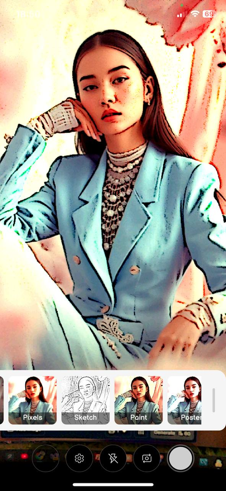

# Filters Camera

Support: [ask your question here](https://github.com/taublast/ShadersCamera/discussions)

Open-source app for iOS, Mac Catalyst, Android and Windows applying hardware-accelerated shaders in real-time to camera preview and saved photos. 
Comes with built-in desktop [SKSL](https://skia.org/docs/user/sksl) editor.

### Open-source version

Filters Camera in the App Store and on Google Play has grown into the full app: many more looks, video recording, light, vignette and distort effects, photo editing, and Premium in-app purchases. The code of that app is closed source.

This repository stays open source as the free version of Filters Camera. It still builds and runs on iOS, Mac Catalyst, Android and Windows with .NET 10: real-time SKSL shaders on the camera preview, photos saved with the look, and the built-in desktop shader editor. Learn from it, fork it, build your own camera on it.

SKSL shaders demonstrate: film grain, cubic splines, various image adjustments, lens distortion effects, edge detection and much more.

Please star ⭐ if you like it!

* Applying shaders to camera preview in real-time
* Switch mirror preview
* Switch full-screen/fit preview
* Saving captured photo with shader effect
* Saving EXIF and injecting custom metadata
* Select camera and photo quality/format
* Edit shaders code in standalone window when running on desktop

Read [the blog article](https://taublast.github.io/posts/FiltersCamera/) 👈

### Latest Changes

* Ready for iOS 27 and Android 16, built with .NET MAUI 10.0.110 and the latest DrawnUI camera
* The camera starts with camera access alone, photo library access is asked when a photo is saved
* Switching to the selfie camera only on devices that have one
* Own app id `com.appomobi.drawnui.shaderscam.oss`, so your build installs next to the store app

### Install

The full app (closed source):

* [AppStore](https://apps.apple.com/us/app/filters-camera/id6749823005?platform=iphone)

* [Google Play](https://play.google.com/store/apps/details?id=com.appomobi.drawnui.shaderscam)

This open-source version: build and run it from this repository on iOS, Mac Catalyst, Android and Windows.

### How To Use

- Tap anywhere on the screen to set current frame as preview
- Choose your real-time filter from previews in drawer menu!
- Open settings for more!

For Windows/Android users best with Photo Link app to instantly view your taken mobile photos!

### Interaction:

- On-screen buttons:  View Captured, Settings, Flash, Source, Capture Photo
- User drawer menu to select filters
- Tap anywhere on the screen to use current frame for drawer previews
- Zoom with fingers
- On desktop long pressing shader preview opens SKSL editor

### On The Roadmap

* Rotate saved photo on iOS if taken while rotated even if rotation turned off for app
* Rotate previews in menu when phone is rotated to landscape
* Add selection indicator for previews, scroll to selected at startup
* Pass rendering scale as uniform for all shaders for full consistency between preview and large capture
* Localization and change language in settings

### Optional To-Do

* Create presets (BW, For Kids etc..)
* Crop manual/presets
* Combine with lens shaders
* Shaders editor for mobile version
* ML Z-axis detection and apply smart bokeh

### .NET MAUI Libs Stack

* [SkiaSharp](https://github.com/mono/SkiaSharp)
* [DrawnUi for .NET MAUI](https://github.com/taublast/DrawnUi)
* [FastPopups for .NET MAUI](https://github.com/taublast/FastPopups)

### Contributing

Contributing to repository is very welcome. Many other nifty shaders could be added, the current UI is also not something fixed.

CI/CD documentation is in `docs/github-actions-cicd.md`.

### Credits

* **App Screenshots** - created with [Hotpot](https://hotpot.ai/)

### Related

* Playing with shaders: [ShadersCarousel](https://github.com/taublast/ShadersCarousel)

* Another `SkiaCamera` usage example: [DrawnUI Demo](https://github.com/taublast/DrawnUi.Maui.Demo)

---

Made with [DrawnUI for .NET MAUI](https://drawnui.net)

---

